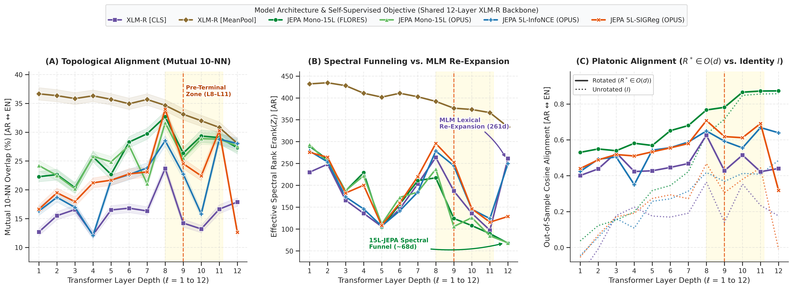
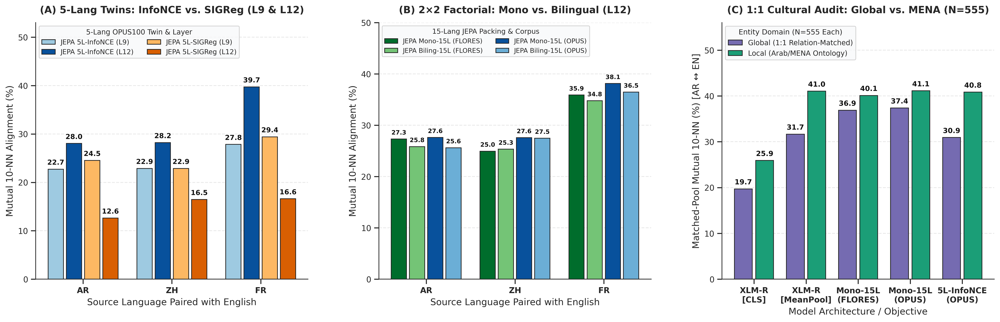

# Cross-Script Representation Geometry & Spectral Dynamics in Multilingual Text-JEPAs

A modular evaluation suite for analyzing cross-lingual representation geometry, orthogonal Procrustes alignment, and layer-wise spectral dynamics across **9 encoder configurations** (`XLM-R` MLM baselines, **6 controlled `BERT-JEPA` variants** spanning InfoNCE vs. LeCun SIGReg and 2×2 Monolingual vs. Bilingual packing, and `mE5-Base` supervised upper bound) on strictly quad-parallel **mLAMA** factual statements (`AR`, `EN`, `ZH`, `FR`).

---

## Key Verified Findings (`N = 1,725`, 25 Relations, 1:1 Cultural Split = `555` per Domain)

1. **Terminal Shattering in SIGReg vs. Monotonic Alignment in InfoNCE (`Table 2`, `L9 → L12`):**
   At pre-terminal layer `L9`, the controlled 5-language OPUS100 twins (`4a. InfoNCE` vs. `4b. LeCun SIGReg`) achieve comparable alignment (`AR 10-NN: 22.73%` vs. `24.53%`; `ZH: 22.88%` vs. `22.88%`; `FR: 27.84%` vs. `29.41%`; `Erank ≈ 236–253d`). Between `L9 → L12`:
   - **InfoNCE (`4a`) surges:** `AR +5.30%***`, `ZH +5.33%***`, `FR +11.89%***` (`RotCos` rises to `0.639 / 0.636 / 0.786`; `5-Fold Top-1 = 50.7% / 56.6% / 81.9%`; `Erank = 250–264d`).
   - **SIGReg (`4b`) shatters:** `AR -11.91%***` (`RotCos -0.300***`, `Erank 252.5 → 128.7`), `ZH -6.42%***` (`RotCos -0.330***`), `FR -12.81%***` (`RotCos -0.329***`), collapsing to `10.8% / 14.4% / 12.3%` Top-1.

2. **Spectral Funneling vs. Platonic Alignment in 15-Language JEPAs (`Table 1`):**
   All 15-language InfoNCE Text-JEPAs (`2a–3b`) achieve very high unrotated cosine alignment (`AR: 0.845–0.857`, `ZH: 0.721–0.762`, `FR: 0.917–0.948`, near-zero rotation gain `+0.006` to `+0.072`) by strongly funneling effective spectral rank down to `51–75d` (versus `261–340d` in `XLM-R` MLM re-expansion), while outperforming `XLM-R [CLS]` across all three language pairs (`p < 10^-3`, BH-FDR).

3. **2×2 Factorial: Monolingual vs. Bilingual Packing (`Table 3`):**
   Across both FLORES and OPUS100 (15-Lang), **monolingual packing** significantly outperforms bilingual packing in Mutual 10-NN on Arabic (`+1.47%***` FLORES, `+2.00%***` OPUS100) and French (`+1.11%**` FLORES, `+1.67%***` OPUS100), while preserving higher effective spectral rank (`61–75d` vs. `51–58d`).

4. **Strict Template-Debiased & 1:1 Cultural Controls (`Tables 4 & 5`):**
   - **Zero-leakage template debiasing (`Table 4`):** Subtracting train-fold relation centroids preserves all significant gains over `XLM-R [CLS]` (`4a. InfoNCE` reaches `47.8% / 49.5% / 76.4%` Top-1 vs. `7.8% / 14.2% / 18.3%` for `4b. SIGReg`).
   - **1:1 Relation-Matched Cultural Audit (`Table 5`, `N = 555` each):** Local Arab/MENA entities exhibit significantly higher AR↔EN alignment than relation-matched Global entities across all 9 models (`p < 0.05` to `p < 10^-3`, BH-FDR).

5. **Pooling-Invariant MeanPool Control (`--pooling_override mean`):**
   Re-evaluating all 9 models with MeanPool rules out `[CLS]`-specific artifacts: at `L9`, `4b. SIGReg` still matches `4a. InfoNCE` (`AR: 37.60% vs. 37.03%`, `ZH: 37.03% vs. 36.67%`, `FR: 47.13% vs. 46.20%`), yet still shatters between `L9 → L12` (`-16.85%***` AR, `-12.22%***` ZH, `-20.79%***` FR; `RotCos -0.188***` to `-0.241***`). Meanwhile, `4a. InfoNCE` (`Top-1 = 70.6% / 75.1% / 93.1%`) and `Mono-15L` consistently outperform `XLM-R [MeanPool]` and bilingual packing across every language pair (`p < 10^-3`, BH-FDR).

---

## Publication Figures & Summary Tables

All 5 statistical tables (`table1`–`table5`), MeanPool control tables (`assets/meanpool_control/`), and figures are archived in [`assets/`](assets/).

### Figure 1: Layer-Wise Topological Alignment, Spectral Funneling & Platonic Procrustes Alignment


### Figure 2: 5-Lang Twins (L9/L12), 2×2 Factorial Packing & 1:1 Cultural Audit


---

## Repository Structure

```text
multilingual-text-jepa-geometry/
├── assets/                      # 300-DPI figures, Tables 1-5 & MeanPool control tables
├── configs/models.yaml          # 9-model registry (XLM-R, 6x BERT-JEPA, mE5-Base)
├── src/
│   ├── data/
│   │   ├── ontology.py          # Normalized MENA gazetteer (whole-word & phrase matching)
│   │   └── build_benchmark.py   # Quad-parallel mLAMA curation (N=1,725) + 1:1 cultural split
│   ├── extraction/
│   │   └── extract.py           # Multi-layer [CLS] & MeanPool extraction + .npz caching
│   └── analysis/
│       ├── geometry.py          # Mutual 10-NN, 5-fold Procrustes (R* vs. I), Erank, debiasing
│       ├── stats.py             # Tables 1-5 with Wilcoxon / Mann-Whitney + BH-FDR
│       └── plots.py             # 300-DPI Figure 1 & Figure 2 (PNG + PDF)
├── scripts/
│   ├── run_extraction.py        # GPU step: build benchmark + extract & cache all 13 layers
│   └── run_analysis.py          # CPU step: compute Tables 1-5 & Figures 1-2 from cache
└── notebooks/colab_runner.ipynb # Thin 4-cell Google Colab launcher
```

---

## Setup

```bash
git clone https://github.com/alisakour/multilingual-text-jepa-geometry.git
cd multilingual-text-jepa-geometry
python -m venv .venv && source .venv/bin/activate
pip install -r requirements.txt
```

---

## Usage (CLI)

### 1. Extract & Cache All Layers (`[CLS]` + `MeanPool`, ~3–4 min on a single GPU)

```bash
python scripts/run_extraction.py --config configs/models.yaml --cache_dir data/cache
```

### 2. Compute Tables 1–5 & Generate 300-DPI Figures (CPU-only from cache)

```bash
python scripts/run_analysis.py --cache_dir data/cache --out_dir results
```

### 3. Optional MeanPool Ablation Control (CPU-only, reuses existing `.npz` cache)

```bash
python scripts/run_analysis.py \
  --cache_dir data/cache \
  --pooling_override mean \
  --out_dir results_meanpool \
  --no_plots
```

Outputs under `results/`:
- `tables/df_jepa_platonic_layer_trajectories.csv`
- `tables/table1_jepa_platonic_benchmark.csv`
- `tables/table2_sigreg_terminal_shattering.csv`
- `tables/table3_monolingual_vs_bilingual_factorial.csv`
- `tables/table4_template_debiased_control.csv`
- `tables/table5_cultural_domain_breakdown.csv`
- `figures/figure1_jepa_platonic_trajectories_1x3.{png,pdf}`
- `figures/figure2_jepa_factorial_and_shattering_1x3.{png,pdf}`
