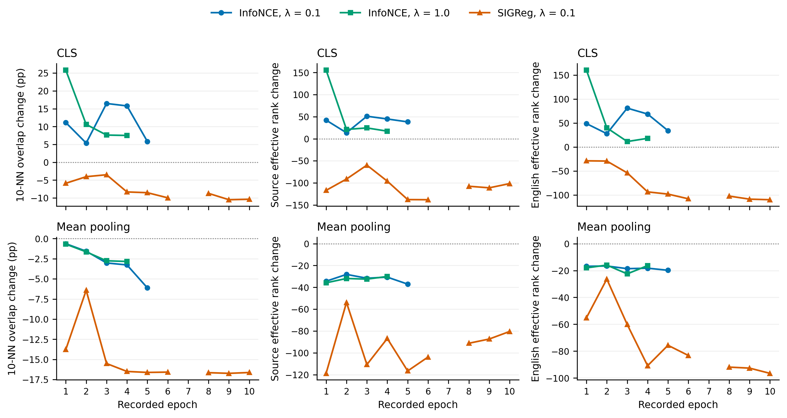
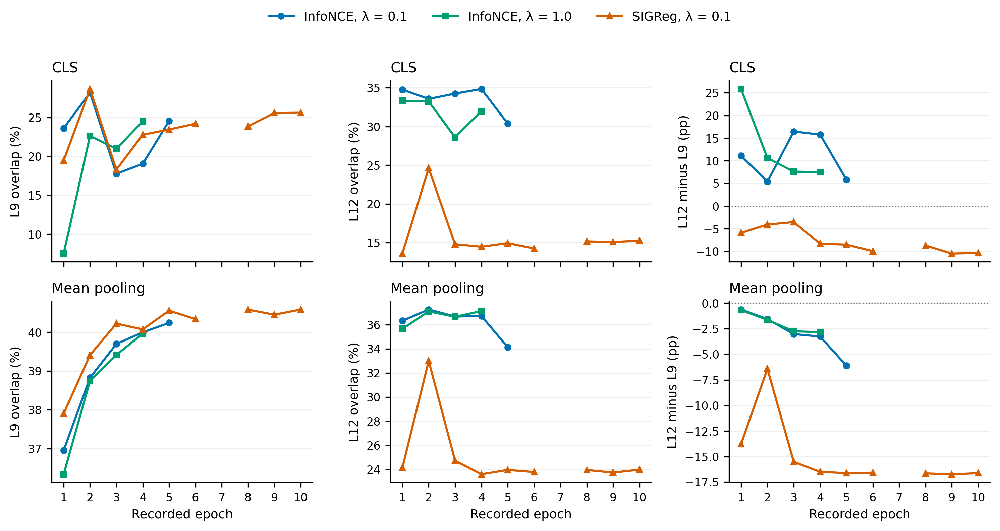

# Checkpoint dynamics of multilingual Text-JEPAs

Layer 9 (L9) and layer 12 (L12) geometry across selected historical revisions of the five-language OPUS100 InfoNCE and SIGReg encoders. The evaluation extends the relation-conditioned neighborhood analysis to intermediate training checkpoints.

## Checkpoints and protocol

| Run (nominal alignment coefficient) | Saved epochs | Recorded steps per epoch |
| --- | --- | ---: |
| InfoNCE (0.1) | 1–5 | 781 |
| InfoNCE (1.0) | 1–4 | 781 |
| SIGReg (0.1) | 1–6, 8–10 | 3,125 |

Eighteen distinct model-weight hashes are recorded in `provenance/checkpoint_manifest.csv`. The selected revisions and coefficients are based on the repository metadata and chronological run groupings. No epoch-7 SIGReg checkpoint was identified in the selected series.

The evaluation uses 1,725 quad-parallel mLAMA statements across 25 relations, comparing Arabic, Chinese and French with English. Representations are extracted in float32 at L9 and L12 with batch size 32 and maximum tokenized length 64. CLS uses the first token; mean pooling includes all attention-masked nonpadding tokens, including special tokens. Neighbor overlap is the percentage of shared indices between each aligned item's two within-language top-10 neighbor sets, excluding self-neighbors, after language-specific centering and L2 normalization. Effective rank is the exponentiated entropy of the normalized singular values of each centered representation matrix (not squared singular values). Shifts are L12 minus L9.

The baseline reproduction check passed all 24 layer/pooling/language-pair records; the largest absolute overlap error was 0.0116 percentage points. The shared InfoNCE coefficient-1.0 epoch-4 evaluation agrees within the numerical tolerances. The consolidated table retains the original pilot evaluation for this shared checkpoint. The coefficient-1.0 trajectory CSVs were provided by Ali Sakour; the baseline, pilot and remaining coefficient-0.1 evaluations were performed by Chaewon Yoon. Both sets are retained with revision provenance.

## Results

- CLS overlap and source effective rank increase from L9 to L12 in all 15 InfoNCE coefficient-0.1 and all 12 coefficient-1.0 checkpoint-language combinations. For SIGReg, both quantities decrease in 26 of 27 combinations. At epoch 3, Arabic-English overlap increases by 1.02 percentage points and Arabic effective rank increases by 6.34.
- Across the 15 coefficient-0.1 CLS epoch-matched comparisons (epochs 1–5, three language pairs), the InfoNCE minus SIGReg shift is positive for both overlap and source effective rank. The overlap contrast ranges from 4.49 to 32.94 percentage points. SIGReg already exhibits negative CLS shifts in all three pairs at epoch 1.
- The coefficient-1.0 InfoNCE mean CLS overlap gap narrows from 25.84 pp at epoch 1 to 7.51 pp at epoch 4. Mean L9 overlap increases from 7.49% to 24.48%, while L12 varies between 28.60% and 33.33%. For coefficient 0.1, the gap fluctuates across epochs (5.38 to 16.47 pp); L9 does not consistently catch up.
- Mean pooling differs from CLS: at coefficient 0.1, both objectives show negative overlap shifts, but InfoNCE has the less negative shift in every epoch-matched pair.





These plots average the three source-language comparisons equally; the English effective rank is the same across pairs for each layer and pooling. Lines connect adjacent observed epochs only. Missing epochs are not interpolated.

## Scope and interpretation

The comparisons are descriptive. The historical [InfoNCE configuration](https://github.com/MarcelMatsal/bert-jepa/blob/5da982e4d851f911d05e23a6eb94adf6d21d4c97/experiments/config_opus100_5lang_infonce.yaml) and [SIGReg configuration](https://github.com/MarcelMatsal/bert-jepa/blob/5da982e4d851f911d05e23a6eb94adf6d21d4c97/experiments/config_opus100_5lang_sigreg.yaml) specify gradient accumulation of four and one, respectively, with mini-batch size 16. If these settings apply, matching recorded steps does not match cumulative exposure, and matching epochs does not match optimizer updates. The nominal coefficients also do not equate loss magnitudes. Runtime training logs and independent seeds are unavailable. The first saved epoch establishes that late-stage training is not necessary for the observed decline, but does not locate its onset or establish a causal relationship between rank and overlap. Checkpoint-language combinations are not independent runs.

## Files and reproduction

`results/` contains the archived 216 metric records and 108 layer shifts, an epoch/pooling summary and the 30 coefficient-matched comparisons (15 per pooling). `provenance/` contains the selected revisions, baseline reproduction checks, original coefficient-1.0 tables and available extraction metadata. Raw benchmark text and model weights are not included.

From this directory, verify saved tables and regenerate the figures without a GPU:

```sh
python -m pip install numpy pandas matplotlib
python scripts/verify_results.py
python scripts/plot_trajectories.py
```

For fresh extraction, use a CUDA-enabled PyTorch environment, install `requirements.txt`, and obtain the original `mlama_quad_parallel_benchmark.csv` through the project data source. Its SHA-256 is `4a8fe28fb1a9ddb73e3431a60a200d80cbf31e0f4dc69967a83469495345404f`.

```sh
python scripts/evaluate_checkpoints.py --benchmark /path/to/mlama_quad_parallel_benchmark.csv --output reproduced --checkpoint infonce_01_e4
```

Omit `--checkpoint` to evaluate all 18 revisions, or repeat the option to select a subset. Fresh extraction checks the benchmark and weight hashes and writes checkpoint-specific numerical comparisons against the saved tables (0.1 pp overlap tolerance and 0.5% relative rank tolerance). The evaluator uses the same extraction and metric functions as the completed continuation experiment; the consolidated command-line entry point is a packaging refactor and has not been rerun end-to-end on GPU.
