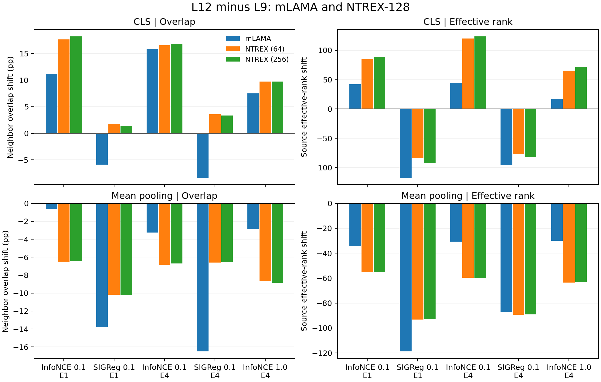

# NTREX-128 validation

Five historical checkpoints evaluated on 1,997 line-aligned English, Arabic, simplified Chinese and French news sentences. Both runs use identical checkpoint revisions, dataset files, pooling methods and metrics. The maximum tokenized sequence length is 64 or 256; all sequences fit within 256 tokens.

## Files

- `results/max_length_64/` and `results/max_length_256/`: original evaluation outputs, including checkpoint manifests, token-length audits, metrics and mLAMA comparisons.
- `results/length_control_comparison.csv`: L12 minus L9 changes for both input limits and the archived mLAMA reference.

## Results

At 256 tokens, InfoNCE (nominal coefficient 0.1) has a larger CLS neighbor-overlap shift than SIGReg in all six epoch-matched language comparisons (epochs 1 and 4). SIGReg's CLS overlap shifts on NTREX are approximately flat to positive (0.005 to 3.73 percentage points), while source-language and English effective rank decrease in all six comparisons. Mean-pooling overlap shifts remain negative for both objectives; at epoch 4, SIGReg has slightly less negative shifts than InfoNCE in all three language pairs. The maximum absolute difference between the 64- and 256-token overlap shifts is 0.96 percentage points (rounded to two decimal places). These observations are descriptive and do not establish a causal relationship between rank and overlap. Dataset size, content and potential training-data overlap are not controlled.

Dataset: [NTREX-128](https://github.com/MicrosoftTranslator/NTREX), revision `468c6b69c7f6a75d31d4743d9daba2af566cc18d` (CC BY-SA 4.0). Cite Federmann, Kocmi and Xin (2022), [NTREX-128](https://aclanthology.org/2022.sumeval-1.4/), and Barrault et al. (2019), [WMT19 findings](https://aclanthology.org/W19-5301/). Raw dataset text and model weights are not included.

## Evaluation protocol

The four source files are downloaded at the pinned dataset revision and verified against their Git blob hashes. All 1,997 aligned rows are retained, including repeated translations. Hidden states are extracted in float32 at layers 9 and 12, using batch size 32. CLS uses the first token; mean pooling averages attention-masked nonpadding tokens, including special tokens. Neighborhood overlap is the percentage of shared indices in the two languages' within-language top-10 cosine-neighbor sets after separate centering and L2 normalization, excluding self. Effective rank is the exponential entropy of normalized singular values of the centered embedding matrix. Shifts are L12 minus L9. The mLAMA reference is the five-checkpoint subset of `../checkpoint_dynamics/results/checkpoint_metrics.csv`.



## Reproduction

Run from `ntrex_validation/`. Verify the archived outputs and regenerate the figure without a GPU:

```sh
python -m pip install numpy pandas matplotlib
python scripts/verify_results.py
python scripts/plot_results.py
```

To extract representations again, use a CUDA-enabled PyTorch environment with the dependencies in `requirements.txt` and internet access to GitHub and Hugging Face. The evaluator checks the selected revision and model-weight SHA-256 before extracting features.

```sh
python -m pip install -r requirements.txt
python scripts/evaluate_ntrex.py --max-length 64
python scripts/evaluate_ntrex.py --max-length 256
python scripts/verify_results.py --reproduced reproduced
```

The evaluator defaults to `reproduced/max_length_N/`, with separate ZIP outputs, and never overwrites the archived results. `--max-new` limits the number of new checkpoints in a run; repeat with the same output directory and settings to resume. The archived outputs are from the completed GPU runs; the consolidated command-line entry point retains their extraction and metric functions but has not been rerun end-to-end on GPU. Runtime versions are recorded in the original evaluation metadata.

These five-checkpoint results do not establish the behavior of later SIGReg checkpoints, other training runs or other evaluation corpora. The mLAMA and NTREX sample sizes, domains and potential training-data overlap differ; the length control addresses truncation within NTREX only. The training-setting caveats in `../checkpoint_dynamics/README.md` also apply here.
