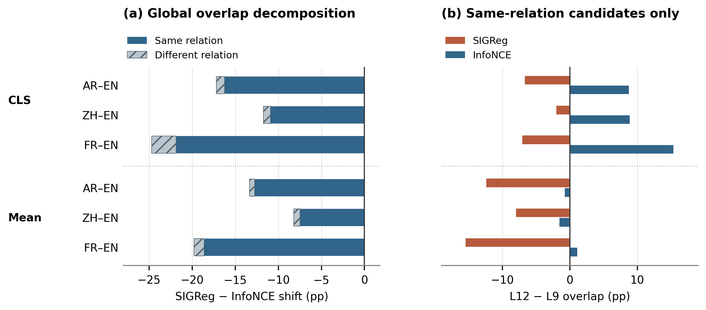

# Relation-conditioned neighborhood alignment

Layer-wise comparison of the five-language OPUS100 BERT-JEPA SIGReg and InfoNCE checkpoints on the quad-parallel mLAMA benchmark (1,725 examples and 25 factual relations). The analysis covers Arabic-English, Chinese-English and French-English with CLS and mean pooling. Shifts denote L12 minus L9 in percentage points (pp).

## Methods and results

1. **Global 10-NN.** Following Table 2, compute shared nearest-neighbor overlap over the full benchmark, then aggregate by relation. For CLS pooling, the SIGReg shift is lower than the InfoNCE shift in all 75 relation-language comparisons.
2. **Cross-relation candidates.** Exclude candidates sharing the query's relation before selecting neighbors. The aggregate SIGReg-minus-InfoNCE contrast remains negative in all six language-pooling settings.
3. **Global overlap decomposition.** Partition the original shared neighbors by whether their relation matches the query's relation. The same-relation component accounts for 88.6% to 95.7% of the aggregate contrast across the six settings.
4. **Within-relation candidates.** Restrict each query to candidates from its own relation. The contrast remains negative in all six aggregate comparisons and 136 of 150 relation-level comparisons (13 positive, one tied). The aggregate contrasts also remain negative after relation-size chance adjustment and after excluding P530 and P190 from the aggregation.



Panel (a) partitions the global contrast into additive components. Panel (b) compares the layer shifts using same-relation candidates only. Both panels report example-weighted means.

## Interpretation

The decomposition locates most of the checkpoint contrast in same-relation shared neighbors. The fixed-candidate control shows that the contrast is not solely attributable to changes in the number of same-relation neighbors entering global top-10 lists. Exclusion checks hold the neighbor graphs fixed and remove relation-level scores from the aggregation. Chance adjustment rescales overlap using independent uniform neighbor sets as a reference. The analysis describes two checkpoints on one benchmark; causal effects of training objectives and factual recall are outside its scope.

## Contents

- `scripts/`: four analysis scripts, CSV validation and figure generation.
- `results/`: eight CSVs with aggregate and relation-level results.
- `figures/`: summary figure in PDF and PNG formats.

## Reproduction

Python 3.9+ and NumPy are required for the four analyses. Matplotlib is required for plotting. The analyses use the original quad-parallel benchmark CSV and the two five-language OPUS100 embedding caches. Each NPZ contains eight arrays (`ar_cls`, `en_cls`, etc.) with shape `[layers, examples, hidden_dim]`. Benchmark rows and cache rows must be in identical order. These input files are not included.

From `relation_neighborhoods/`, place the three input files in `inputs/` and run the following commands (use `py` instead of `python` on Windows if needed):

```sh
python -m pip install numpy matplotlib
python scripts/check_jepa_relations.py --benchmark inputs/mlama_quad_parallel_benchmark.csv --cache inputs/maktzgls__bert-jepa-sigreg-opus100-5lang-sigreg.npz --out-dir reproduced/sigreg
python scripts/jepa_objective_relation_controls.py --benchmark inputs/mlama_quad_parallel_benchmark.csv --sigreg inputs/maktzgls__bert-jepa-sigreg-opus100-5lang-sigreg.npz --infonce inputs/maktzgls__bert-jepa-infonce-opus100-5lang-infonce.npz --out-dir reproduced/matched
python scripts/jepa_neighbor_decomposition.py --benchmark inputs/mlama_quad_parallel_benchmark.csv --sigreg inputs/maktzgls__bert-jepa-sigreg-opus100-5lang-sigreg.npz --infonce inputs/maktzgls__bert-jepa-infonce-opus100-5lang-infonce.npz --out-dir reproduced/decomposition
python scripts/jepa_within_relation_control.py --benchmark inputs/mlama_quad_parallel_benchmark.csv --sigreg inputs/maktzgls__bert-jepa-sigreg-opus100-5lang-sigreg.npz --infonce inputs/maktzgls__bert-jepa-infonce-opus100-5lang-infonce.npz --out-dir reproduced/within
```

The commands write to a separate directory to preserve the archived outputs. To verify and plot the archived CSVs without any caches:

```sh
python scripts/verify_results.py
python scripts/plot_relation_results.py
```

## Input provenance

The archived CSVs were generated from the supplied benchmark and cached final-checkpoint representations. Exact checkpoint revision hashes are not recorded in the available cache metadata. The validation script checks archived CSV consistency; reproducing the tensor-level analyses requires the original inputs.
