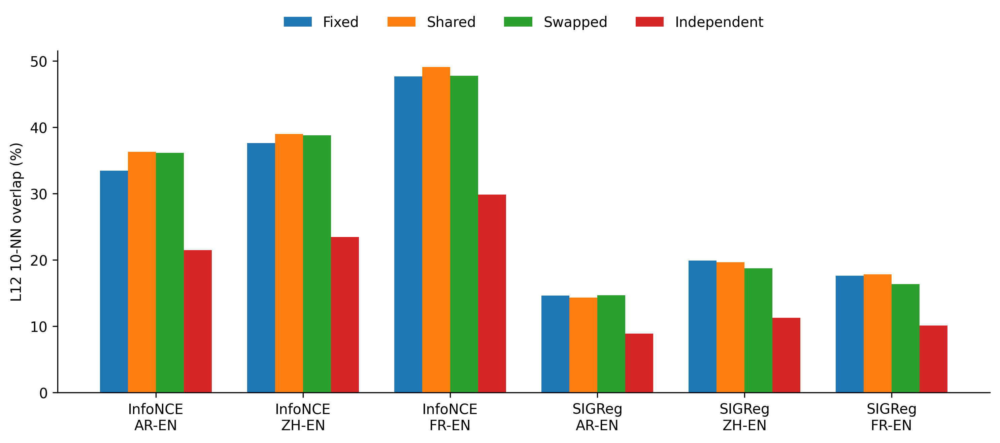
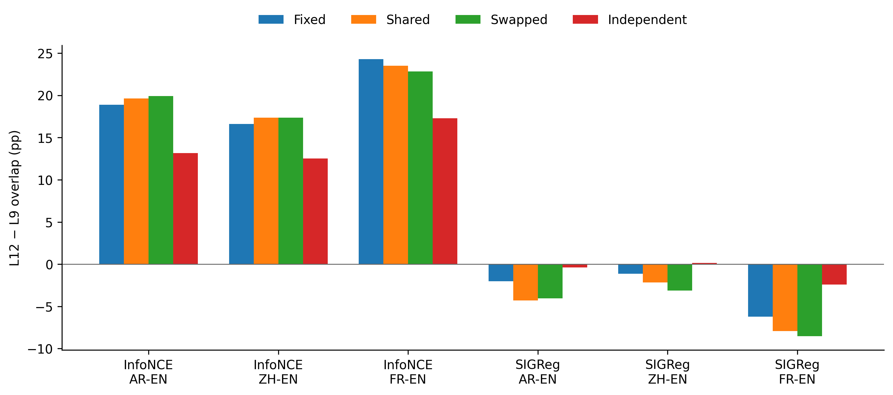

# mLAMA template assignment controls

Evaluation of how sentence-template diversity and cross-language template assignment affect neighborhood alignment in multilingual Text-JEPA encoders.

## Experimental design

The evaluation uses 858 quad-parallel facts from the three largest relations in the original mLAMA benchmark: P530 (diplomatic relations, 447 facts), P190 (twin cities, 270) and P47 (shared borders, 141). Each condition retains the subject and object labels, relation and row identity in English, Arabic, Chinese and French. The original statements are reconstructed exactly, and two alternative templates are used for each relation and language.

Both checkpoints use the nominal alignment coefficient 0.1 at epoch 4. Model revisions and weight hashes are listed in `provenance/checkpoint_manifest.csv`. Representations are extracted in float32 at layers 9 and 12 with batch size 32, a 64-token limit, and CLS and attention-masked mean pooling. Alignment is the mean percentage of shared indices in the two language-specific top-10 neighbor lists, excluding self-neighbors, after centering and L2 normalization. The initial pilot also measures effective rank using normalized singular values of centered representations. Layer shifts are L12 minus L9, in percentage points (pp) for overlap.

| Condition | Template assignment within each relation |
| --- | --- |
| Original | Original mLAMA wording |
| Fixed A / B | One alternative template per language for every fact |
| Shared | Balanced binary assignment, identical across languages |
| Swapped | The same partition as English, with opposite template IDs in the source languages |
| Independent | Separately randomized balanced assignments for each source language |

The initial pilot uses the shared assignment at seed 42 and its complement. The assignment control compares shared and independent assignments across five seeds (42, 17, 101, 202, 303). The partition control adds swapped assignments. For each seed, results for a mixed assignment and its complement are averaged, balancing template frequencies across the two runs even for odd relation sizes. The seeds vary template assignments, not model training.

## Results

- In the pilot, shared mixing of the two alternatives makes SIGReg's CLS layer shift 1.39 to 2.58 pp more negative than the average fixed-template shift across the three language pairs. Absolute L12 overlap differs by less than 0.3 pp.
- Relative to shared assignments, independent assignments reduce SIGReg's CLS alignment drop by lowering L9 overlap more than L12 overlap. Absolute overlap decreases at both layers for both objectives and both pooling methods.
- Shared and swapped assignments differ by at most 1.07 pp at L9 and 1.99 pp at L12. Swapped assignments exceed independent assignments in all 60 checkpoint/seed/pooling/language comparisons at each layer, by 7.60 to 23.00 pp at L9 and 5.59 to 19.63 pp at L12.
- Under independent assignments, InfoNCE retains positive mean CLS shifts (+12.51 to +17.30 pp across languages) and small positive mean-pooling shifts (+0.22 to +2.00 pp). SIGReg's mean CLS shifts range from -2.40 to +0.14 pp, while mean-pooling shifts are negative (-7.81 to -5.51 pp).

The overlap metric is sensitive to whether templates partition facts in the same way across languages, even when corresponding facts use opposite template IDs. These controls do not isolate the cause of the differences between mLAMA, NTREX and MASSIVE.





The figures average both complementary assignments and all five assignment seeds for the mixed conditions. Fixed values average alternatives A and B. Each language pair is shown separately.

## Verification and scope

The partition run reproduces all 528 assignment metric records to floating-point precision and passes all 96 pilot overlap checks (maximum discrepancy 0.01166 pp). No sentence exceeds the token limit and neither model reports missing or mismatched encoder weights. The three archived runs contain 120, 528 and 768 metric records, respectively, including repeated measurements.

Ali Sakour reviewed the Arabic templates and confirmed their naturalness and accuracy. Independent review of the English, Chinese and French templates has not been documented; see `provenance/template_review.md`. The evaluation covers three symmetric relations, two alternatives per relation and language, and one checkpoint per objective. The assignment and partition controls measure overlap only, not effective rank. Matching epochs does not match optimizer steps (3,124 versus 12,500 recorded steps). The results are descriptive and do not represent independent training replicates.

## Files and reproduction

`results/pilot/`, `results/assignment/` and `results/partition/` retain the original run outputs. `results/partition_summary.csv` aggregates the final partition comparison. `provenance/` contains the template bank, review record, checkpoint manifest and SHA-256 hashes of all archived result files.

Verify the archived results and regenerate the summary and figures without a GPU, from this directory:

```sh
python -m pip install numpy pandas matplotlib
python scripts/verify_results.py
python scripts/plot_results.py
```

For fresh extraction, install `requirements.txt` in a CUDA-enabled PyTorch environment. Obtain the original `mlama_quad_parallel_benchmark.csv` from the project data source (the same benchmark used by `checkpoint_dynamics/`) and place it in `inputs/`. Its SHA-256 must be `4a8fe28fb1a9ddb73e3431a60a200d80cbf31e0f4dc69967a83469495345404f`. Raw benchmark text and model weights are not included in this directory.

```sh
python scripts/build_conditions.py
python scripts/evaluate_templates.py
python scripts/evaluate_assignment_control.py
python scripts/evaluate_partition_control.py
```

Fresh outputs are written to `reproduced/`. The archived runs completed on GPU; the current command-line entry points have been checked locally but not rerun end-to-end on GPU.
